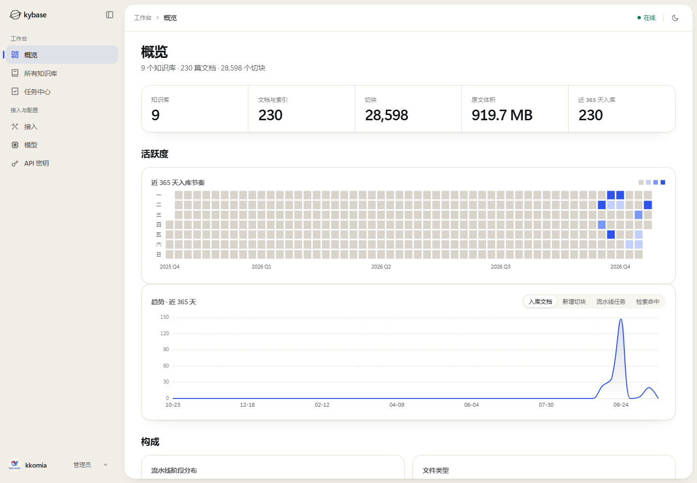

# kybase

**自托管的知识库服务：把资料变成 Agent 能引用、能溯源的证据。**

摄入 → 解析 → 切块 → 向量化 → 混合检索（向量 + BM25，RRF 融合）→ **返回带出处的原文片段**，
而不是一段生成好的回答。

MIT · 自托管 · 三容器 · **MCP / REST / Skill 三条等价接入路径**

---

## 它是什么

kybase 是一个**知识库服务**：负责把文件变成可检索的索引，再把「哪一段原文能回答这个问题」
交给调用它的 Agent。它不生成回答，不做对话、记忆、笔记、技能、沙箱——那些属于 Agent 侧。

三个界面之外的事实：

- **检索先给判定**：`summary` 一句话说明候选多少、收敛后留了几条；`distribution` 给出完整分布
  与 `fit`（`strong` / `weak` / `none` / `unknown`，这份资料到底对不对得上）；`decision` 记录
  这次按什么收敛的；原文排在它们之后。
- **出处诚实**：页码只在文档自己的分页标记与页数自洽时才给，否则 `page` 为 `null`——
  报一个翻不到原文的页码比不报更糟。每条命中还标出它是哪条通道捞上来的（`basis` /
  `lexical_score`）。
- **能翻页看全**：命中太多时用 `keep` / `min_score` / `per_doc` 收敛；要「把某个主题看全」
  就按 `offset` / `next_offset` 一路翻到 `null`——判定在每一页上逐字相同。
- **异步摄入**：上传 → 逐文件探测 → 解析 → 切块 → 向量化 → 索引，租约 / 退避 / 断点续跑；
  云端与本地解析按文件动态路由，所有格式统一转成 Markdown，向量化只针对 Markdown。
- **账号与准入**：用户、会话、API 密钥；库分享、库范围钥匙、管理员都是知识库语义的资产。

## 一次检索长什么样

```http
POST /api/v1/search
Authorization: Bearer <API Key>

{
  "query": "城市绿地对儿童近视的影响",
  "kb_ids": ["kb_xxx"],
  "keep": 5,
  "min_score": 0.42
}
```

```json
{
  "summary": "候选 38 条，收敛后保留 5 条（强相关 3 / 部分相关 2）。",
  "distribution": {
    "fit": "strong",
    "count": 38,
    "above_baseline": 5,
    "suggested": { "keep": 5, "min_score": 0.42, "per_doc": 2 }
  },
  "decision": {
    "keep": 5,
    "min_score": 0.42,
    "per_doc": 2,
    "decided_by": "model",
    "fit": "strong",
    "dropped": 33,
    "unscored_kept": 0
  },
  "hits": [
    {
      "document_name": "城市绿地暴露与儿童视力的关联.pdf",
      "page": 4,
      "text": "……原文片段……",
      "score": 0.71,
      "similarity": 0.62,
      "basis": "vector",
      "lexical_score": 12.4
    }
  ],
  "next_offset": null
}
```

> 上面是响应结构示意（节选），不是某次真实请求的统计结果。`score` 是融合分，
> `similarity` 才是余弦；`basis` 是 `vector` / `fulltext` 时分别表示这条来自哪条通道。

## 界面

真实运行中的管理台（1440 × 1000，数据来自作者自托管实例做演示用的一次性副本）：



带滚动叙事和可交互检索演示的展示页：**https://kkomia.github.io/kybase/**（源码在 `site/`）。

## 三条接入路径

| 路径 | 谁在用 | 入口 |
|---|---|---|
| **MCP**（stdio + Streamable HTTP） | Claude Desktop、Cursor、Codex 等会说 MCP 的客户端 | `python -m app.mcp_server.server --transport http --port 8765` |
| **REST**（`/api/v1/*`） | 任何能发 HTTP 的系统 | `http://<host>:8080/api/v1`，OpenAPI 在 `/api/v1/openapi.json` |
| **官方 Skill**（`skills/`） | 只会 shell 与 HTTP 的运行环境 | `skills/` 下的 Skill 包（`SKILL.md` + 纯 REST 查询脚本） |

三条路径语义等价：工具面指纹（`--list-tools` 末行 / `serverInfo.version` 的 `+mcp.<指纹>` /
`GET /api/v1/tools`）用来判断契约有没有变过。MCP 每个请求都要 `Authorization: Bearer <API Key>`，
**没有匿名放行**。

## 快速开始

**干净机器（带 docker）：四件套一键起**

```bash
git clone https://github.com/kkomia/kybase.git
cd kybase
docker compose -f deploy/docker-compose.yml up -d --build
# 界面   http://localhost:8080
# 健康   http://localhost:8080/api/v1/health
```

> 这份 compose 会连同 PostgreSQL（pgvector）与 MinIO 一起建起来。
> 其中的 postgres 服务已按同一份定义在真实服务器上跑通，**整体「一键起」尚未在干净机器上实测**；
> 如果你跑的时候踩到坑，欢迎开 issue。

**已有 PG + MinIO 的机器：应用层三件套**

```bash
cd deploy/nas
cp -i /dev/null .env   # 按 README 填 KYLAB_PG_PASSWORD / KYLAB_S3_ACCESS_KEY / KYLAB_S3_SECRET_KEY
docker compose up -d --build
```

**起来之后还差一步**：去「模型」页登记一个嵌入模型，否则建库会被拒——服务不替你猜用哪个模型。

## 仓库结构

```
backend/app/
  api/          REST 面（knowledge-bases / documents / folders / search / chunks /
                wiki / tabular / data-sources / shares / tasks / lifecycle / webhooks /
                maintenance / stats / provider / tools / api-keys）
  services/     摄入、切块、检索、嵌入、Wiki、表格、连接器、分享
  storage/      postgres_impl（向量 + 全文 + 元数据）、duckdb_impl（表格副本）
  parsers/      插件式解析器层
  pipeline/     摄入状态机
  workers/      队列消费者
  mcp_server/   对外 MCP（stdio + Streamable HTTP）
  core/         配置、异常、安全、HTTP、日志等纯契约
backend/tests/  单元 / 集成 / 基准测试
frontend/       管理台（Vite 8 + React 19 + TS + Tailwind 4 + pnpm）
skills/         官方 Skill（独立交付物，不 import app/）
scripts/        门禁脚本族（check-backend / check-frontend / check_layering / ci …）
deploy/         compose：干净机器四件套 / NAS 应用层三件套
docs/           部署指南、外部接入指南、界面设计、交接文档
site/           展示页（纯静态 HTML / CSS / JS，发布到 GitHub Pages，无构建步骤）
```

## 文档

| 文档 | 给谁 |
|---|---|
| [部署指南](docs/部署指南-v0.1.md) | 想自己部署一套的运维 / 工程师（两种形态、变量表、升级与回滚） |
| [外部接入指南](docs/外部接入指南-v0.1.md) | 接入方：MCP / REST / Skill / 窄 API 四条路径的完整契约 |
| [界面设计](docs/界面设计-v0.2.md) | 想理解管理台视觉与交互约定的人 |
| [展示页设计](docs/展示页设计-v0.2.md) | 想改 GitHub Pages 展示页的人（方向、动效、内容口径） |
| [交接文档](docs/交接文档-v0.1.md) | 接手开发的人（进度、坑、遗留） |

> 部署与交接两份文档里保留了作者自托管环境的具体信息（内网地址、NAS 路径、历史回滚形态），
> 是运行记录，不是通用要求。对外宣传页见 **https://kkomia.github.io/kybase/**。

## 状态

- 自托管实例已经在跑：三个容器（backend / mcp / frontend）healthy，管理台、REST、MCP 三个入口。
- 版本线 `0.1.0`；镜像 `kybase-backend:0.1.0` / `kybase-frontend:0.1.0`。
- 已知待办：
  - **配置分家**：环境变量前缀仍是 `KYLAB_`，API Key 前缀仍是 `kylab_sk_` / `kylab_st_`，
    `X-Kylab-*` 头与默认桶名也是旧名。改字面会断现有部署与已发出的密钥，要按
    「保留 / 双读 / 迁移」逐项决定——见交接文档。
  - 表格副本（DuckDB）是单文件单写者，多副本部署前必须先改造。
  - 干净机器那份 compose 尚未整体实测。

## 参与

- 提 issue / PR 都可以；提交信息用 `<类型>: <简述>`，类型限 `feat/fix/docs/test/refactor/chore`。
- 门禁：`sh scripts/check-backend.sh` 与 `sh scripts/check-frontend.sh`（Windows 用同名 `.ps1`）。
- 这个仓库的前身是作者另一个项目里的知识库模块，2026-10 拆成独立服务，现在的名字是 **kybase**。

## 许可

[MIT](LICENSE) © 2026 kkomia
